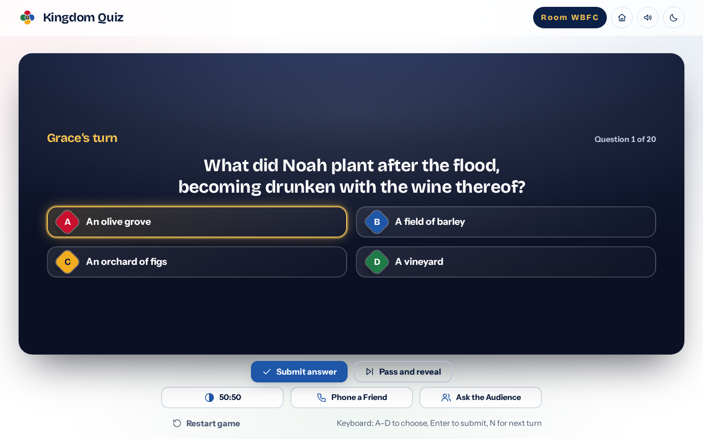

<div align="center">


# Kingdom Quiz

**A host-led Bible trivia game for church game nights.**

[](https://github.com/rccgkd/bible-trivia-game/actions/workflows/deploy.yml)
[](https://rccgkd.github.io/bible-trivia-game/)

[Play now](https://rccgkd.github.io/bible-trivia-game/) ·
[Report an issue](https://github.com/rccgkd/bible-trivia-game/issues/new/choose) ·
[Documentation](docs/)

</div>

<p align="center">
  
</p>

## About

Kingdom Quiz turns a laptop and a projector into a quiz-show stage. One person hosts on the big screen while up to four players take turns answering. Everyone else in the room joins from their own phone with a four-letter code and votes when a player asks the audience for help.

It is built for church game nights, youth meetings and Bible study groups, and it is free to use with no account or install.

## Features

- **600 Bible questions** covering names, places, numbers, speeches and events from Genesis to Revelation. Every answer is followed by the full King James Version verse.
- **150 Church History questions** from the Day of Pentecost to the modern era, each with a short factual explanation.
- **One to four players** taking turns, with +10 for a correct answer, −5 for a wrong one and 0 for a pass.
- **Three lifelines per player:** 50:50, Phone a Friend (30-second timer) and Ask the Audience (a live 20-second vote).
- **Live audience voting** with results that fill in on both the host screen and every phone.
- **Light and dark themes**, sound effects you can mute, and keyboard shortcuts for the host.
- **Works offline after the first visit.** The game itself needs no connection; only audience voting does.

## How to use it

1. Open the [live site](https://rccgkd.github.io/bible-trivia-game/) and choose **Host the game** on the device connected to the screen.
2. Choose the number of players, their names, a category and how many questions each player answers.
3. Press **Start game**. A four-character room code appears at the top of the screen.
4. Audience members open the same site on their phones, choose **Join as audience** and type the code.
5. Players answer in turn. The host submits each answer, reveals it and moves to the next turn.

| Key (host) | Action |
| --- | --- |
| `A` – `D` or `1` – `4` | Choose an answer |
| `Enter` | Submit the chosen answer |
| `N` | Next turn, once an answer is revealed |

## Tech stack

- Plain HTML, CSS and JavaScript (ES modules). There is no framework and no bundler.
- [Firebase](https://firebase.google.com/) Realtime Database and anonymous authentication for live audience rooms, loaded only when a room is used.
- Self-hosted fonts: Bricolage Grotesque and Instrument Sans.
- GitHub Actions and GitHub Pages for building, checking and hosting.

## Project structure

```
index.html            The app: every screen lives in this one page
404.html              Page shown for addresses that do not exist
css/                  Design tokens (tokens.css) and styles (style.css)
js/                   Game engine, audience view, rooms, interface helpers, question bank
assets/               Fonts, app icons and the social preview image
docs/                 Setup and maintenance guides
scripts/              Build and lint checks that run on every deployment
database.rules.json   Security rules for the Firebase Realtime Database
.github/              Automated build, deployment and security workflows
```

## Contributing

Found a mistake in a question, or have an idea? [Open an issue](https://github.com/rccgkd/bible-trivia-game/issues/new/choose) or send a pull request from the GitHub website. See [CONTRIBUTING.md](CONTRIBUTING.md) for how to add or correct questions.

## Security

Please report vulnerabilities privately. See [SECURITY.md](SECURITY.md).

## Credits

- Bible text: King James Version (public domain).
- Fonts: [Bricolage Grotesque](https://github.com/ateliertriay/bricolage) and [Instrument Sans](https://github.com/Instrument/instrument-sans), both under the [SIL Open Font License 1.1](assets/fonts/OFL-BricolageGrotesque.txt).
- Sound effects are generated in the browser. There are no audio files.
